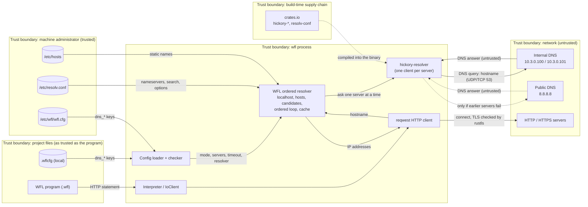

# Ordered DNS resolution and `.wflcfg` DNS servers

**Status:** Approved and dispatched by the Maintainer on 2026-11-18; implemented in PR [WebFirstLanguage/wfl#808](https://github.com/WebFirstLanguage/wfl/pull/808) in two Red→Green cycles. Sections marked *(as built)* record where the implementation refined this plan.
**Risk:** New feature (not an I1 bug), so it needs a Maintainer dispatch decision. Testing risk class **R3**: it handles untrusted network input (DNS answers) and affects backward compatibility.
**Threat model:** [Appendix A](#appendix-a-threat-model) (STRIDE).

---

## 1. Summary

The Linux `wfl` binary is statically linked against musl. musl's resolver sends every DNS query to **all** nameservers in `/etc/resolv.conf` at the same time and uses the first reply. On a machine whose resolver list is `10.3.0.100, 10.3.0.101, 8.8.8.8`, Google's public resolver often answers first, so internal hostnames fail, and every internal hostname is sent to Google. This change gives WFL its own DNS resolver, built on `hickory-resolver`, that asks nameservers **one at a time, in the listed order, using glibc's rules**. It also adds `.wflcfg` settings so a developer can list their own DNS servers, independent of the operating system, and choose how they combine with the system list. reqwest's built-in `hickory-dns` feature is deliberately **not** used, because on its own it does not query in order and it silently falls back to Google DNS.

## 2. Problem statement

**Who has the problem:** anyone who runs WFL programs with the published Linux tarball (or the Docker image built from it) on a network with internal DNS names.

**What happens today:**

1. The Linux artifact is built for `x86_64-unknown-linux-musl` (see `build-linux` in `.github/workflows/nightly.yml`). It is static on purpose: the old glibc build would not run on Debian 12 or Ubuntu 22.04 (wfl#616), so going back to glibc is not an option.
2. Rust's standard library and reqwest's default resolver call `getaddrinfo`, which in a musl binary is musl's own resolver.
3. musl sends the query to every listed nameserver (up to 3) **in parallel** and accepts the **first** reply that is either a success or "no such name" (NXDOMAIN).
4. With `nameserver 10.3.0.100`, `nameserver 10.3.0.101`, `nameserver 8.8.8.8`, the public resolver frequently replies first with "no such name" for internal hosts such as `wiki.lan`. The WFL program then fails with "host not found", while glibc programs on the same machine succeed, because glibc asks the servers in order.
5. Every lookup also sends the internal hostname to `8.8.8.8`, which reveals internal names to a third party.

**Why the `.wflcfg` setting is also needed:** on some servers the Maintainer cannot change the operating system's DNS configuration. WFL needs a way to use the right DNS servers anyway, set per project or per machine in WFL's own configuration.

**Why not just turn on reqwest's `hickory-dns` feature:** the source of `reqwest 0.13.4` and `hickory-resolver 0.26.3` shows that the feature on its own:

- asks **2 nameservers at the same time** (`ResolverOpts::num_concurrent_reqs` defaults to 2);
- **reorders** nameservers by measured speed (`ServerOrderingStrategy::QueryStatistics`);
- **stops** at a server that answers "server failure" or "refused" instead of trying the next one (glibc moves on);
- offers no reqwest setting to change any of the above;
- **silently switches to Google Public DNS** (`8.8.8.8`) if `/etc/resolv.conf` cannot be read.

So the same race could still happen, and a new leak would be added.

## 3. Goals and non-goals

### Goals

- **G1 — Ordered lookups on Linux.** By default, the Linux binary asks the nameservers from `/etc/resolv.conf` one at a time, in the listed order, using glibc's rules: a "no such name" answer is final, and WFL only moves on to the next server when a server does not answer, or answers "server failure", "refused", "not implemented", "format error", or something it cannot parse.
- **G2 — WFL-owned DNS servers.** A developer can list DNS servers in `.wflcfg` (local or global). The developer chooses whether WFL uses **only** those servers (the default), uses them **before** the system list, or uses them **after** the system list.
- **G3 — No hidden servers.** WFL never sends a DNS query to a server that is not in the effective list: no Google fallback, no `127.0.0.1` fallback, and no silent fallback to musl.

### Non-goals (for this version)

- **NG1 — Windows and macOS default behavior is unchanged.** They keep the OS resolver unless `dns_servers` is set. *(Assumption 1)*
- **NG2 — Database lookups.** `sqlx` connections (for example `postgres://db.lan`) keep using the system resolver. The docs say plainly that the DNS settings apply to **HTTP requests** only. *(Assumption 2)*
- **NG3 — No new WFL syntax.** Programs see the change only through `.wflcfg`. *(Assumption 3)*
- **NG4 — No encrypted DNS.** Only plain DNS on port 53, over UDP with TCP fallback. No DNS-over-HTTPS, DNS-over-TLS, or DNSSEC validation. *(Assumption 4)*
- **NG5 — No protection against DNS rebinding.** WFL does not block a public name that resolves to a private or loopback address. This is the same as today and as glibc; see residual risks.

## 4. Users and roles

| Role | Description | Trust |
|---|---|---|
| WFL program author / operator | Writes or runs `.wfl` programs; edits `.wflcfg` | Trusted (a local `.wflcfg` is as trusted as the program next to it; it can already enable shell execution) |
| Machine administrator | Controls `/etc/resolv.conf`, `/etc/hosts`, `/etc/wfl/wfl.cfg` | Trusted |
| Docker image user | Runs the published image, which is built from the Linux tarball | Trusted for their own container |
| DNS servers | Internal (`10.3.0.100`, `10.3.0.101`), public (`8.8.8.8`), or override servers | **Untrusted** (answers are network input) |
| The network path | LAN, Wi-Fi, VPN, internet | **Untrusted** |

There are no logins, accounts, roles, secrets, or admin interfaces in this feature.

## 5. Scope

### MVP (this version)

1. A WFL-owned ordered resolver, used by reqwest through `ClientBuilder::dns_resolver(...)`.
2. It is the default on Linux (static musl tarball, Docker image, and from-source glibc builds).
3. Four new configuration keys: `dns_servers`, `dns_servers_mode`, `dns_timeout_seconds`, `dns_resolver`.
4. Clear, Elm-style DNS error messages that name every server tried and its outcome.
5. Validation in `wfl --configCheck`, display in `wfl --dump-env`, and per-server logging at `log_level = debug`.
6. An in-memory answer cache.
7. Documentation, a Dev Diary entry, and full test coverage under the R3 rules.

### Later (not in this version)

- Use the same resolver for `sqlx` database connections (NG2).
- Support `before_system` / `after_system` on Windows and macOS (Assumption 20).
- Optional protection against DNS rebinding (NG5).
- Encrypted DNS (NG4).

## 6. User flows

### Flow 1 — Default lookup on Linux (no DNS settings in `.wflcfg`)

1. A WFL program runs `open url "http://wiki.lan/api"` (or any HTTP statement).
2. reqwest asks the WFL resolver for `wiki.lan`.
3. The resolver handles `localhost` / `*.localhost` itself (always loopback), then checks the hosts file (`/etc/hosts`). On a match, it returns those addresses and stops.
4. The resolver checks the in-memory cache. On a hit, it returns the cached addresses and stops.
5. The resolver builds the candidate names from the `search` list and `ndots` (glibc rules).
6. For each candidate name, in order, it asks `10.3.0.100` first.
   - If `10.3.0.100` answers with addresses, or with "no such name", that answer is final for the candidate.
   - If `10.3.0.100` does not answer within the timeout, or answers "server failure" / "refused", it asks `10.3.0.101`, then `8.8.8.8`.
7. The whole server list is tried up to `attempts` times.
8. reqwest connects to the returned address.

### Flow 2 — Override with `only` (the default mode)

1. The developer writes, in `.wflcfg` (or `/etc/wfl/wfl.cfg`):
   ```ini
   dns_servers = 10.3.0.100, 10.3.0.101
   ```
2. The resolver uses exactly `10.3.0.100`, then `10.3.0.101`. It never contacts the servers in `/etc/resolv.conf`.
3. This works on Linux, Windows, and macOS.

### Flow 3 — Override combined with the system list (Linux)

1. The developer writes:
   ```ini
   dns_servers = 10.3.0.100, 10.3.0.101
   dns_servers_mode = before_system
   ```
2. The effective list is `10.3.0.100, 10.3.0.101`, then the `/etc/resolv.conf` servers. A server that appears in both lists is asked once, at its first position.
3. With `after_system`, the order is reversed. The docs warn that `after_system` does not help when a system server answers "no such name" first, because that answer is final.

### Flow 4 — Troubleshooting

1. The developer runs `wfl --dump-env`. It shows the resolver in use (`wfl` or `system`), the mode, the effective server list in order, the file each server came from, the timeout, and the attempts.
2. The developer sets `log_level = debug`. Each lookup logs the servers asked, in order, with the outcome of each.
3. A failed lookup's error message lists the same information without debug logging (FR-14).

### Flow 5 — Off switch

1. If the new resolver causes a problem on a machine, the operator writes `dns_resolver = system` in `/etc/wfl/wfl.cfg` (or a project `.wflcfg`).
2. WFL then uses the OS resolver exactly as before this change (musl in the tarball).
3. Any `dns_servers` setting is ignored, and a config warning says so.

## 7. Functional requirements

Each requirement has testable acceptance criteria. "Fake DNS server" means a real UDP/TCP DNS responder started by the test on `127.0.0.1` with an ephemeral port. The tests never use the public internet (`testing.md`: the presubmit suite is hermetic).

### Ordered lookup engine

**FR-01 — Servers are asked one at a time, in order.**
- AC1: With servers A, B listed in that order, A answers correctly after 300 ms, and B answers "no such name" immediately: WFL uses A's answer in **100 of 100** runs.
- AC2: The same test fails on the build before this change (Red evidence), or the Red commit shows the equivalent failure through the real binary.
- AC3: While A is being asked, no query reaches B (asserted by B's query log).

**FR-02 — glibc failover rules.**
- AC1: A answers "no such name" → B receives **no** query, and the lookup fails with a "name not found" error.
- AC2: A answers with addresses, including an empty NOERROR ("no data") → final; B receives no query.
- AC3: A does not answer within the timeout → B is asked, and B's answer is used.
- AC4: A answers SERVFAIL, REFUSED, NOTIMP, or FORMERR → B is asked immediately, without waiting for the timeout.
- AC5: A sends a reply WFL cannot parse → it is treated like "server failure", and B is asked.
- AC6: A replies with the truncated (TC) flag → WFL retries the same server over TCP before moving on.
- AC7: A reply with the wrong query ID, wrong question, or from the wrong source address/port is ignored, and does not end the wait.
- AC8: A component test pins how each hickory error kind (in 0.26: `NetError` and `DnsError` variants) maps to a WFL outcome: final answer, try the next server, or retry over TCP. It covers NXDOMAIN, empty NOERROR, SERVFAIL, REFUSED, NOTIMP, FORMERR, timeout, I/O error, and parse error. A hickory upgrade that changes this mapping (for example, turning SERVFAIL into a final answer) fails the test instead of silently changing behavior.

**FR-03 — Attempts.**
- AC1: The whole server list is tried `attempts` times (from `options attempts:N` in `/etc/resolv.conf`; default 2; values above 5 are treated as 5, as in glibc).
- AC2 *(as built)*: With every server silent, `timeout:1` and `attempts:2`, the lookup gives up after two rounds (about 2 seconds, not 1 and not 3). Rounds are measured by time, not by counting packets: within one round, hickory re-sends the same UDP question to the **same** server after about 1.2× the measured round-trip time (at least ~333 ms, up to 3 re-sends). This is not configurable through hickory's options, never contacts another server, and helps with lost packets. *(Assumption 37)*

**FR-04 — Search domains and `ndots`, glibc order.**
- AC1: WFL builds the candidate names itself from `search` / `domain` and `ndots` (default 1). Each candidate is asked across **all** servers, in order, before the next candidate is tried.
- AC2: "No such name" for a candidate moves on to the **next candidate**, not the next server.
- AC3: A name with a trailing dot (`host.example.`) is absolute: no search domains are added.
- AC4: The order of candidates and servers is checked against a fixed expected sequence in a component test.

**FR-05 — `/etc/hosts` and `localhost`.**
- AC1: A name in the hosts file is answered from that file, and **no** DNS query is sent. The hosts file is `/etc/hosts` on Linux and macOS, and `%SystemRoot%\System32\drivers\etc\hosts` on Windows, so turning on the WFL resolver with `dns_servers` never silently ignores it. The file is re-read when its modification time changes, so edits are seen by long-running programs (as with musl today). *(Assumption 34)* *(as built)* The change check is one `stat` (file metadata) call per lookup, not rate-limited; the file itself is read again only when its modification time or size changed. For comparison, musl opens and reads the whole hosts file on every lookup. *(as built, review round 3)* `resolv.conf` gets the same check on every lookup, before the cache, because a change must clear the cache (Assumption 36). The hosts file is decoded leniently (Assumption 40).
- AC2: `localhost` and any name ending in `.localhost` resolve to the loopback addresses (`127.0.0.1`, `::1`), and are **never** sent to a DNS server, even if `/etc/hosts` is missing (RFC 6761).
- AC3: All existing web tests that use `http://localhost:<port>` pass unchanged.

**FR-06 — IPv4 and IPv6.**
- AC1: For each server, WFL asks for A and AAAA records together, and returns IPv4 and IPv6 addresses to reqwest so its "happy eyeballs" connection logic still works.
- AC2: For one server, the A and AAAA results are combined like this. *(Assumption 29)*
  1. Either query returns addresses → **final**. Use that server's addresses only (both types if both returned some). Consequence, by design: if a server returns IPv4 addresses while its IPv6 query fails, an IPv6 address that only a later server knows is never seen. The answer stays one server's answer, as with glibc.
  2. Otherwise, either query returns NXDOMAIN → **final**: "name not found".
  3. Otherwise, both queries return an empty NOERROR → **final**: "no addresses for this name".
  4. Otherwise (one query returns an empty NOERROR and the other gets no reply, SERVFAIL, REFUSED, NOTIMP, FORMERR, or an unparseable reply) → **not final**: ask the next server. This keeps an IPv4-only internal host working when a server fails only for A records. It is slightly more forgiving than glibc, which can stop here.
- AC3: Fake-server test for case 4: server A returns an empty NOERROR for AAAA, and SERVFAIL for A (and, in a second test, no reply for A); server B returns an A record. WFL uses B's address.
- AC4: Fake-server test for case 3: server A returns an empty NOERROR for both types. The lookup fails with "no addresses for this name", and server B receives no query.

### Configuration

**FR-07 — `dns_servers`.**
- AC1: The value is a comma-separated list of IP addresses with optional ports: `10.3.0.100`, `10.3.0.100:5353`, `fd00::1`, `[fd00::1]:53`. The default port is 53.
- AC2: Hostnames are rejected, with an explanation (a DNS server's name would itself need DNS).
- AC3: The order written is the order used. Duplicates are asked once, at their first position.
- AC4: It works in both `/etc/wfl/wfl.cfg` (global) and `.wflcfg` (local). Local wins, as for every key.
- AC5: An empty value (`dns_servers =`) means "not set", which clears an inherited global value.
- AC6: Setting it turns on the WFL resolver on every platform, unless `dns_resolver = system` is written explicitly (FR-10).
- AC7: IPv6 link-local addresses with a zone ID (for example `fe80::1%eth0`) are **rejected** in this version, with a message suggesting a global or unique-local address instead. *(Assumption 32)*

**FR-08 — `dns_servers_mode`.**
- AC1: The values are `only` (the default when the key is missing), `before_system`, and `after_system`. Matching is case-insensitive, and surrounding spaces are ignored.
- AC2: `only` → the effective list is exactly `dns_servers`. A test proves that a resolv.conf server receives **zero** queries.
- AC3: `before_system` → `dns_servers`, then the resolv.conf servers. `after_system` → the resolv.conf servers, then `dns_servers`. Duplicates are removed (the first position is kept).
- AC4: Setting the mode without `dns_servers` gives a config warning, and the mode is ignored. *(as built)* Config warnings go to the WFL log (as for every other key), and `wfl --dump-env` shows them in its DNS section.
- AC5: Any other value is a config error (FR-13).

**FR-09 — `dns_timeout_seconds`.**
- AC1: A whole number of seconds from 1 to 30. It overrides `options timeout:N` from `/etc/resolv.conf`.
- AC2: Without it, the resolv.conf timeout is used (glibc caps it at 30); without either, the timeout is 5 seconds.
- AC3: An invalid value (0, negative, above 30, or not a number) gives a config warning naming the key and the accepted range (in the WFL log; `wfl --configCheck` reports it as an error), and the default is used. A wrong timeout cannot cause a leak, so warning (not failing) is safe here.
- AC4: Each try waits the same fixed time. *(Assumption 27: glibc lengthens the wait in later rounds; this small difference is documented.)*

**FR-10 — `dns_resolver` (the off switch).**
- AC1: The values are `wfl` and `system`. The default is `wfl` on Linux and `system` on Windows and macOS.
- AC2: `system` restores today's behavior exactly: reqwest's default `getaddrinfo` resolver. A test proves no WFL resolver code is used (for example, `wfl --dump-env` reports `system`, and a fake server in `dns_servers` receives no query).
- AC3: An explicit `dns_resolver = system` together with `dns_servers` → `system` wins, `dns_servers` is ignored, and a config warning says so.
- AC4: Any other value is a config error (FR-13).

**FR-11 — Non-Linux platforms.**
- AC1: On Windows and macOS, `dns_servers` with mode `only` works as on Linux.
- AC2: `before_system` and `after_system` on Windows or macOS produce a clear "not supported on this platform yet" error in `--configCheck`, and at the first lookup. *(Assumption 20)*
- AC3: When the WFL resolver is on, Windows and macOS still honor their hosts file (FR-05 AC1).

### Errors, visibility, and cache

**FR-12 — No servers at all.**
- AC1: If the WFL resolver is active and the **effective server list is empty**, the lookup fails **immediately**. No query is sent anywhere. The list is empty only when `dns_servers` is not set and `/etc/resolv.conf` is missing, unreadable, or has no `nameserver` lines.
- AC2: The error says which sources were checked (`/etc/resolv.conf`, `dns_servers`) and shows the one-line fix (`dns_servers = <your DNS server>`). It also mentions that `dns_servers = 127.0.0.1` restores the old musl behavior for a local resolver.
- AC3: Programs that make no network requests still run normally (the check happens at the first lookup, not at startup).
- AC4: With `before_system` or `after_system`, a missing, unreadable, or empty system list is **not** an error, because `dns_servers` still gives a non-empty list. WFL uses the `dns_servers` alone, logs one warning saying the system list was unavailable (in the WFL log), and `wfl --dump-env` shows it. No query goes to any server outside `dns_servers`. *(Assumption 33)*

**FR-13 — Invalid configuration fails closed.**
- AC1: An invalid `dns_servers` entry, or an invalid `dns_servers_mode` / `dns_resolver` value, is reported by `wfl --configCheck` with the file, the line, and the offending value.
- AC2: At runtime, the first lookup fails with the same explanation. WFL does **not** fall back to the system servers.
- AC3: Programs that make no network requests still run normally.
- AC4: Malformed, oversized (for example a 1 MB value), and adversarial values (control characters, thousands of entries, IPv6 zone IDs, ports `0` and `65536`) are covered by unit tests, and never panic.

**FR-14 — Clear lookup errors (Principle 4).**
- AC1: A failed lookup reports the hostname, each server asked in order, where each server came from, and the outcome of each, plus a hint. Example:
  ```text
  Could not find the address of "wiki.lan".

  I asked these DNS servers, one at a time, in this order:
    1. 10.3.0.100:53  (from /etc/resolv.conf)  no reply within 5 seconds
    2. 10.3.0.101:53  (from /etc/resolv.conf)  answered "server failure"
    3. 8.8.8.8:53     (from /etc/resolv.conf)  answered "no such name" (final)

  Hint: if this is an internal name, list your internal DNS servers in .wflcfg:
      dns_servers = 10.3.0.100, 10.3.0.101
  ```
- AC2: The message never contains URL paths, query strings, headers, or bodies. Only the hostname appears.
- AC3: The error reaches the WFL program through the existing HTTP error path, so `try`/`when` handling keeps working.

**FR-15 — Answer cache.**
- AC1: Final answers are cached in memory by name, checked before any server is asked (so a cache hit avoids waiting on a dead first server).
- AC2: Positive answers are kept for their DNS TTL, capped at 1 day. "No such name" answers are kept for their negative TTL, capped at 30 seconds. *(Assumption 25)*
- AC3: The cache holds at most 1,024 names; the least recently used entry is dropped first.
- AC4: The cache lives only as long as the process; nothing is written to disk.

**FR-16 — `wfl --dump-env` shows the DNS setup.**
- AC1: The output shows the resolver (`wfl` / `system`), the mode, the effective server list in order with the source file of each, the timeout and its source, and the attempts.
- AC2: Invalid settings are shown as invalid, with the reason.

**FR-17 — `wfl --configCheck` / `--configFix` know the new keys.**
- AC1: All four keys are known settings (no "unknown key" warning), and their values are validated as in FR-07 to FR-10.
- AC2 *(as built)*: `--configFix` never adds or changes DNS settings. The DNS keys have no default written by `--configFix`, so invalid DNS values are reported for the user to fix by hand, and a generated config file never switches resolvers.
- AC3: The `wfl-config-lint` workflow accepts the new keys.

**FR-18 — Debug logging.**
- AC1: At `log_level = debug`, each lookup logs the name, each server asked, and its outcome and timing.
- AC2: At `info` and above, nothing new is logged.

**FR-19 — Documentation ships with the feature.**
- AC1: `Docs/reference/configuration-reference.md` documents all four keys (quick table and detailed sections), with examples and the `after_system` warning.
- AC2: The HTTP client documentation explains the ordered lookup, the error format, and that database connections are not covered (NG2).
- AC3: `Docs/reference/supported-platforms.md` and the Linux install notes mention the resolver behavior.
- AC4: A Dev Diary entry goes under `History/dev-diary/2026/`.
- AC5: Every changed WFL code example passes `python scripts/validate_docs_examples.py`. INI snippets are checked by a test that feeds them to the config parser.

## 8. Non-functional requirements

**NFR-01 — No added latency when the first server is healthy.** A lookup sends exactly one query per address type to the first server, and returns as soon as it answers. No waiting for other servers. A cache hit answers without any network traffic.

**NFR-02 — Bounded waiting.** When every server is silent, the worst case for one lookup is `candidates × attempts × servers × timeout`. Here `candidates` is the number of names built from the search list (FR-04). Examples:
- a fully qualified name with 3 servers: 1 × 2 × 3 × 5 s = 30 s;
- an unqualified name with `search a b` and `ndots:1` (3 candidates): 3 × 2 × 3 × 5 s = 90 s.

The request's existing timeout and the program's execution deadline cap the **whole** lookup, across all candidates. A lookup is never longer than either of them. Test: with two search domains and every server silent, the lookup ends at the request timeout, not later. When the request is cancelled or times out, all in-flight DNS queries for it are dropped (test: no fake server receives a query after cancellation).

**NFR-03 — Concurrency (`testing.md` §11.3).** The resolver is fully asynchronous on the existing Tokio runtime. Test: while one request waits on a silent DNS server, a second request in the same program (`main loop concurrently:` or a web handler) to a name served by a healthy server completes promptly.

**NFR-04 — The static binary stays static.** The `Assert the binaries are statically linked` step (no `PT_INTERP`) still passes. hickory is pure Rust, so no new C toolchain is needed.

**NFR-05 — Backward compatibility (sacred).** Every `TestPrograms/*.wfl`, the web-server end-to-end tests, the Docker runtime validation, and the Debian 12 smoke test pass unchanged. The off switch (`dns_resolver = system`) restores the previous behavior exactly. The one intended difference (FR-12: no silent `127.0.0.1` fallback) is documented with its one-line fix.

**NFR-06 — Hermetic tests.** All DNS tests use fake servers on `127.0.0.1` with ephemeral ports, plus temp-dir config files. No test needs the public internet, root access, or a real `/etc/resolv.conf` change in the developer's machine.

**NFR-07 — Binary size.** The size change of `wfl` (stripped) is recorded in the PR. There is no hard budget, but the PR must explain any growth above 2 MB.

**NFR-08 — Platforms.**

| Platform | Default resolver | `dns_servers` modes |
|---|---|---|
| Linux x86_64 musl (tarball, Docker) — Tier 2 | `wfl` (ordered) | `only`, `before_system`, `after_system` |
| Linux glibc (built from source) | `wfl` (ordered) | all three |
| Windows (MSI) | `system` | `only` |
| macOS (from source) | `system` | `only` |

## 9. Security requirements

Each requirement points to the threat(s) in [Appendix A](#a6-threats) that it mitigates.

| ID | Requirement | Mitigates |
|---|---|---|
| **SEC-01** | Every query uses a random 16-bit query ID and a random UDP source port (hickory's defaults; WFL must not turn them off). A reply is accepted only if its ID, question, and source address/port match the query. A test sends mismatched replies from the fake server and proves they are ignored. | T-01 |
| **SEC-02** | The docs state plainly that plain DNS can be forged by someone on the network, that HTTPS (certificate checking) is the protection, and that sensitive data should never be sent over plain HTTP. They also explain DNS rebinding (a public name resolving to `127.0.0.1` or a private address) as a known, unmitigated risk. | T-01, T-12 |
| **SEC-03** | Ordered querying with glibc rules (FR-01 to FR-04). A reply from a later server can never replace a final answer from an earlier server. | T-02, T-05 |
| **SEC-04** | `wfl --dump-env` and the lookup error show which file each DNS server came from (FR-14, FR-16). The docs warn that a project's `.wflcfg` can change DNS servers, so a downloaded project's `.wflcfg` should be reviewed like its code. | T-03 |
| **SEC-05** | Malformed, oversized, truncated, or mismatched DNS replies never panic, hang, or end the lookup early. They are treated as "server failure" (or ignored, for mismatched replies), and the next server is asked. Adversarial fake-server tests cover: garbage bytes, a truncated header, a wrong question, a compression-pointer loop, a reply over 64 KB on TCP, a CNAME chain longer than hickory's limit, and a reply after the timeout. | T-04 |
| **SEC-06** | WFL sends DNS queries only to servers in the effective list. There is no implicit server (no `8.8.8.8`, no `127.0.0.1`). A test with mode `only` proves a resolv.conf server receives zero queries. | T-05 |
| **SEC-07** | reqwest's `hickory-dns` feature stays **off**. A test (or CI check on `cargo tree -e features`) fails if it is ever enabled. A test with an unreadable resolv.conf proves the lookup fails with the FR-12 error and contacts no server. | T-06 |
| **SEC-08** | DNS details are logged only at `debug` level, and only the hostname (never the URL path, query, headers, or body). A test asserts this for both the log and the error message. | T-07 |
| **SEC-09** | Per-try timeout is bounded to 1–30 s and attempts to at most 5. The whole lookup, across every search-list candidate (`candidates × attempts × servers × timeout`), runs inside the request's existing timeout and execution deadline, and cancellation drops in-flight queries (NFR-02). | T-08 |
| **SEC-10** | The resolver is async and never blocks a runtime thread. The §11.3 concurrency test (NFR-03) proves one stuck lookup does not delay unrelated requests. | T-09 |
| **SEC-11** | The cache is bounded (1,024 names, least recently used dropped first), and TTLs are capped (1 day positive, 30 s negative). | T-10, T-18 |
| **SEC-12** | With no servers found, the lookup fails immediately with the FR-12 message (sources checked, one-line fix). The off switch and the `dns_servers = 127.0.0.1` fix are documented. | T-11 |
| **SEC-13** | hickory is added with `default-features = false` and only the features needed for plain DNS over UDP/TCP on Tokio. Builds use `--locked`. Both `Cargo.lock` and `fuzz/Cargo.lock` are updated together. hickory updates are R3 under the existing Dependabot rule (`Docs/contributing/issue-policy.md`: "parsing of untrusted input"), so only patch updates with a security-focused review are eligible. | T-13 |
| **SEC-14** | Every failed lookup lists the servers asked, their sources, and each outcome (FR-14). Debug logs record the same for successful lookups (FR-18). | T-14 |
| **SEC-15** | Invalid DNS configuration fails closed: it never falls back to the system servers (FR-13). | T-15 |
| **SEC-16** | `localhost` and `*.localhost` always resolve to loopback and are never sent to any DNS server (FR-05 AC2). | T-16 |
| **SEC-17** | No environment variable, hidden flag, or test-only hook can change DNS servers or the resolver in a release build. Tests inject configuration through real `.wflcfg` files in temp directories (and component tests through the resolver's constructor), not through production seams. *(as built)* The only environment input is Windows' own `%SystemRoot%`, which locates the hosts file exactly as Windows does; changing it for a process only redirects that process's own hosts file. | T-17 |

## 10. Architecture overview

### Components

| Component | Where | What it does |
|---|---|---|
| Config loader | `src/config.rs` (existing) | Parses the four new keys from the global and local files; records the source file of each value |
| Config checker | `src/wfl_config/checker.rs` (existing) | Knows and validates the new keys |
| **WFL ordered resolver** (new) | `src/interpreter/dns.rs` (new module) | Builds the effective server list; handles `localhost`, `/etc/hosts`, search/ndots candidates, the ordered loop, failover rules, and the cache; implements `reqwest::dns::Resolve` |
| Per-server query client | `hickory-resolver` 0.26 (new direct dependency) | One hickory resolver per server, configured for exactly one server: `num_concurrent_reqs = 1`, `attempts = 1`, cache off, hosts file off, no search list, `trust_negative_responses = true`. WFL's loop decides what happens next. The mapping from hickory's error kinds to WFL outcomes is pinned by a component test (FR-02 AC8) |
| resolv.conf parser *(as built)* | WFL's own parser in `dns.rs` (about 60 lines) | Reads `nameserver` (first three, as glibc's `MAXNS`), the last `search`/`domain` line, and `options ndots/timeout/attempts` (capped at 15/30/5). No extra dependency, and none of hickory's Windows/macOS system-config code |
| System sources *(as built)* | `SystemSources` in `dns.rs` | Where the resolv.conf and hosts file are read from (the real paths in production). A Rust library parameter so tests can use temporary files; no `.wflcfg` key, environment variable, flag, or WFL program can reach it (SEC-17). `resolv.conf` and the hosts file are re-read when their modification time or size changes |
| HTTP client | `IoClient::http_client_with_redirects` in `src/interpreter/mod.rs` (existing) | Calls `.dns_resolver(...)` when the resolver setting is `wfl`; unchanged when it is `system` |

### Lookup algorithm (WFL resolver)

1. If the name is `localhost` or ends with `.localhost`, return loopback.
2. If the platform's hosts file has the name (FR-05: `/etc/hosts`, or the Windows hosts file), return those addresses.
3. If the cache has a live entry, return it.
4. Build the effective server list from the mode (FR-08). If it is empty, fail with the FR-12 error. With `before_system` / `after_system` and no usable system list, use `dns_servers` alone and warn (FR-12 AC4).
5. Build the candidate names (FR-04).
6. For each candidate: repeat `attempts` times: for each server in order: ask A + AAAA, and wait up to the timeout. Combine the two results with the FR-06 AC2 rules.
   - Final (addresses, NXDOMAIN, or empty NOERROR for both types) → stop asking servers for this candidate.
   - Not final (no reply, SERVFAIL, REFUSED, NOTIMP, FORMERR, an unparseable reply, or one type empty while the other failed) → next server.
   - Truncated → retry this server over TCP.
7. If a candidate got addresses, cache and return them. If it got NXDOMAIN, try the next candidate. If every candidate ended in NXDOMAIN, cache the negative answer and fail with "name not found" (FR-14).
8. If no server gave a final answer, fail with the FR-14 message listing every server and outcome.

### Tech stack and hosting

- Rust 2024, Tokio, `reqwest 0.13.4` (`json`, `stream`; **no** `hickory-dns` feature), `hickory-resolver 0.26.x` (direct, minimal features), `resolv-conf`.
- Built in CI by the existing jobs: `build-linux` (static musl, Blacksmith runner) and the Windows MSI job. No new CI job is required, apart from the SEC-07 feature check, which can be a test.
- Runs on users' machines and in the Docker image (`debian:bookworm-slim`). There is no server-side component.

## 11. Data

| Data | Where | Sensitivity | Retention |
|---|---|---|---|
| Hostnames being looked up | Memory; sent in DNS queries to the servers asked | Medium (internal names reveal network layout) | Duration of the lookup; in the cache up to its TTL |
| Resolved IP addresses | Memory (cache) | Low–Medium | Up to TTL (max 1 day; negative max 30 s); gone when the process exits |
| DNS configuration (`dns_*` keys) | `.wflcfg`, `/etc/wfl/wfl.cfg` | Low | As long as the files exist (user-managed) |
| Debug log lines with hostnames | WFL log output, only when `log_level = debug` | Medium | Governed by the existing logging settings |

Nothing new is written to disk by WFL. There are no backups to manage.

## 12. Integrations

| External system | Direction | Data | Notes |
|---|---|---|---|
| DNS servers from `/etc/resolv.conf` | Out: query (hostname, type). In: answer (addresses, codes) | Hostnames out; IPs in | Plain DNS, UDP/53 with TCP fallback; answers are untrusted |
| DNS servers from `dns_servers` | Same | Same | Same |
| `/etc/resolv.conf` | In (read only) | Server list, search list, options | Admin-controlled |
| `/etc/hosts` | In (read only) | Static name → IP mappings | Admin-controlled |
| HTTP/HTTPS servers | Unchanged | Unchanged | rustls certificate checks unchanged |
| `hickory-resolver`, `resolv-conf` crates | Build time | Code | Supply chain; see SEC-13 |

## 13. Success metrics

1. **Race test:** WFL uses the first server's answer in **100 of 100** runs (FR-01 AC1), and the Red evidence shows the old build failing it.
2. **Failover, override, and error tests:** every acceptance criterion in FR-02 to FR-18 has a passing test, recorded in the PR's §15 evidence table.
3. **No regressions:** all required CI checks pass on the exact PR head, including Linux and Windows integration, the web tests, Docker runtime validation, and the fuzz compile check.
4. **Real-world check (Maintainer, after the nightly ships):** on the server with `10.3.0.100, 10.3.0.101, 8.8.8.8`, a WFL script calling an internal host succeeds on every run for 24 hours, and a packet capture (`tcpdump`) shows **no** queries for internal names reaching `8.8.8.8` while `10.3.0.100` is healthy.

## 14. Rollout plan and milestones

There is no deadline.

| Milestone | What happens | Done when |
|---|---|---|
| M1 — Plan approved | The Maintainer reviews this PRD and dispatches the work | Maintainer says go |
| M2 — Red | Test-only commit: the race, failover, override, error, and config tests, all failing for the intended reason | Red commit pushed; failures recorded |
| M3 — Green + docs | The resolver, config keys, error messages, `--dump-env`/`--configCheck` changes, docs, Dev Diary; lockfiles updated | All tests pass locally; presubmit block green |
| M4 — Review and CI | PR into `dev` with the §15 evidence template; R3 security-focused independent review; all required checks green on the exact head | Approved by an eligible reviewer; merged by the Maintainer (the authoring agent never merges its own PR) |
| M5 — Nightly | The next Linux nightly ships the ordered resolver on by default | Nightly published; Docker smoke green |
| M6 — Real-world check | Success metric 4 on the Maintainer's server | 24 hours clean; `tcpdump` clean |

**Rollback:** per machine, `dns_resolver = system` in `/etc/wfl/wfl.cfg`. Project-wide, revert the PR.

## 15. Assumptions

"You decide" means the Maintainer answered "no preference" and the default was chosen for them. "Default" means the interviewer proposed it and the Maintainer confirmed it at a section checkpoint. "Default (written)" means it was added while writing this document and has **not** been confirmed yet.

1. Windows and macOS keep the OS resolver by default; setting `dns_servers` turns on the WFL resolver on any platform. — *you decide*
2. Database (`sqlx`) lookups are out of scope; docs say the DNS settings apply to HTTP requests only. — *you decide*
3. No new WFL syntax. — *you decide*
4. No encrypted DNS; plain DNS on port 53, UDP with TCP fallback. — *you decide*
5. Key names: `dns_servers`, `dns_servers_mode` (`only` / `before_system` / `after_system`), `dns_timeout_seconds`, `dns_resolver`. — *default*
6. Server entries are IP addresses with an optional port; no hostnames. — *default*
7. Invalid entries fail closed: `--configCheck` reports them, the first lookup errors, non-network programs still run. — *default*
8. `/etc/hosts` and the resolv.conf `search` / `ndots` / `timeout` / `attempts` options are honored; global then local config, local wins. — *default*
9. The docs warn that `after_system` does not help when a system server answers "no such name" first. — *default*
10. DNS waiting counts toward the existing request timeout and execution deadline. — *default*
11. Answers are cached in memory for their TTL. — *default*
12. On Linux the WFL resolver is the default for both musl and from-source glibc builds. — *default*
13. Code lives in a new `src/interpreter/dns.rs`, wired in at `IoClient::http_client_with_redirects`. — *default*
14. Only plain-DNS hickory features are enabled; `Cargo.lock` and `fuzz/Cargo.lock` are updated together. (`fuzz/Cargo.toml` depends on the `wfl` crate by path, so hickory will appear in `fuzz/Cargo.lock`.) — *default*
15. Testing risk class R3. — *default*
16. At `log_level = debug`, every server asked and its outcome is logged; errors always list the servers tried. — *default*
17. `wfl --dump-env` shows the DNS setup in use. — *default*
18. The off switch is `dns_resolver = system`; the default is `wfl` on Linux and `system` on Windows/macOS. — *default*
19. An explicit `dns_resolver = system` wins over `dns_servers`, with a warning. — *default*
20. On Windows and macOS only `dns_servers_mode = only` is supported in this version. — *default*
21. `dns_timeout_seconds` is 1–30; invalid → warning and default; `attempts` works like glibc (the whole list is tried that many times). — *default*
22. The Docker image inherits the new behavior; no Dockerfile change is expected. — *default*
23. This is a new feature: the Maintainer's go-ahead after reading this plan is the dispatch decision; the PR targets `dev`; the author agent does not merge it. — *default*
24. WFL builds the search-domain candidate list itself so the order matches glibc (each candidate across all servers before the next candidate). — *default (written)*
25. Cache limits: 1,024 names, positive TTL capped at 1 day, negative TTL capped at 30 seconds. — *default (written)*
26. A server that appears in both lists (`before_system` / `after_system`) is asked once, at its first position. — *default (written)*
27. Each try waits the same fixed timeout; glibc lengthens the wait in later rounds. This difference is documented. — *default (written)*
28. `attempts` is capped at 5 and defaults to 2, as in glibc. — *default (written)*
29. A and AAAA results from one server are combined by the FR-06 AC2 rules: addresses or NXDOMAIN are final; empty for both types is final; one type empty while the other failed is **not** final, so the next server is asked. Only the final server's addresses are used. — *default (written; revised after PR review)*
30. `localhost` and `*.localhost` always resolve to loopback without DNS (RFC 6761), matching musl. — *default (written)*
31. Per-server resolvers are built with hickory's `TokioResolver` (one server each). *(as built)* resolv.conf is parsed by WFL's own small parser instead of the `resolv-conf` crate (one dependency fewer; hickory's system-config feature stays off). — *default (written; revised during implementation)*
32. IPv6 link-local DNS servers with a zone ID (`fe80::1%eth0`) are rejected in `dns_servers` in this version, with a clear message. — *default (written after PR review)*
33. With `before_system` / `after_system`, a missing or empty system list is not an error: WFL uses `dns_servers` alone and warns once. Only an empty effective list is the FR-12 error. — *default (written after PR review)*
34. The WFL resolver reads the platform's hosts file (`/etc/hosts`, or `%SystemRoot%\System32\drivers\etc\hosts` on Windows) and re-reads it when it changes. — *default (written after PR review)*
35. glibc parity for resolv.conf: only the first three usable `nameserver` lines are used, and a repeated line still uses up a slot (glibc counts lines, not distinct servers); the last `search` or `domain` line wins; a search entry of `.` is ignored; `nameserver` entries with an IPv6 zone ID are skipped and do not use up a slot. — *default (written during implementation; duplicate counting fixed in review round 3)*
36. `resolv.conf` is re-read when its modification time or size changes, like the hosts file, so long-running programs pick up DHCP or VPN changes. A change also clears the answer cache, and the check happens before the cache is consulted, so no answer from the old servers or search list is reused. — *default (written during implementation; cache clearing added in review round 3)*
37. hickory's UDP re-sends within one try (to the same server) are accepted; FR-03 counts rounds, not packets. — *default (written during implementation)*
38. When every server is silent for one search-list name, the search stops there (glibc stops on a timeout); when servers answered with failures, the next search-list name is tried (glibc continues after SERVFAIL). — *default (written during implementation)*
39. At most six search domains are used (glibc's classic `MAXDNSRCH`), so the worst case in NFR-02 is bounded by `7 names × 5 attempts × 3 servers × 30 s` before the request deadline even applies. Extra domains are listed as skipped in `--dump-env`. — *default (written in review round 3)*
40. The hosts file and `resolv.conf` are decoded leniently: UTF-16 with a byte-order mark, UTF-8 with or without a BOM, and otherwise UTF-8 with invalid bytes replaced, so one stray byte cannot make WFL ignore the file. An existing hosts file that cannot be read is logged once. — *default (written in review round 3)*
41. On glibc builds (from source or distribution packages), the Linux default also replaces glibc's Name Service Switch, so mDNS (`.local`), `myhostname`, and LDAP/SSSD host sources are no longer consulted. This is documented, with `dns_resolver = system` as the escape hatch. Whether to narrow the default to musl builds only is an **open decision for the Maintainer** (raised in review). — *default (written in review round 3)*

## 16. Open questions

These are technical points to settle while building. None of them needs an answer from the Maintainer before work starts.

1. ~~**Search-domain order.**~~ *Resolved:* `unqualified_names_try_the_search_list_in_glibc_order` and `ndots_trailing_dot_and_domain_follow_glibc` pin the order against real DNS servers, and a unit test pins the candidate list.
2. ~~**`/etc/hosts` edge cases.**~~ *Resolved:* WFL parses the hosts file itself; tests cover several addresses, IPv6, aliases, comments, case, invalid lines, and re-reading after an edit.
3. ~~**End-to-end test of the system path.**~~ *Resolved:* the system path is tested through `OrderedResolver::from_plan_with_sources` with a temporary `resolv.conf` and real DNS servers on `127.0.0.1`–`127.0.0.3` sharing one port (Linux), and the real binary's `--dump-env` shows the Linux default reading `/etc/resolv.conf`. No mount namespace or production seam was needed.
4. **Later version:** should `sqlx` database connections use the same resolver (NG2)?
5. **Later version:** should `before_system` / `after_system` work on Windows and macOS (Assumption 20)?

---

## Appendix A: Threat Model

### A.1 Scope

This threat model covers DNS name resolution for **outbound HTTP requests** made by the WFL interpreter (`wfl` binary) after this change: the WFL ordered resolver, its configuration keys, and its use of `hickory-resolver`. It applies to the Linux static musl artifact and the Docker image built from it (where the resolver is on by default), from-source Linux glibc builds, and Windows/macOS builds where `dns_servers` is set. Version: the first WFL release that contains this change (a `26.11.x` or later nightly). Out of scope: `sqlx` database lookups, the WFL web server (`listen`), and the language server (`wfl-lsp`), none of which use the new resolver.

### A.2 Data-flow diagram



### A.3 Assets

| Asset | Why it matters | Sensitivity |
|---|---|---|
| Correctness of name → address answers | A wrong answer sends the program's request, and any data in it, to the wrong machine | **High** |
| Confidentiality of internal hostnames | Internal names reveal the network layout and services to third parties | **Medium** |
| Availability of lookups | Automation scripts and web handlers fail or stall without DNS | **Medium** |
| Data in plain-HTTP requests (for example API tokens in headers) | Exposed if a request reaches the wrong machine | **High** |
| Integrity of the `wfl` binary's dependencies | A compromised crate runs with the program's privileges | **High** |
| DNS configuration (`dns_*` keys) | Controls which servers see and answer every lookup | **Medium** |

### A.4 Threat actors

| Actor | Motivation | Capability |
|---|---|---|
| On-path network attacker (same LAN, Wi-Fi, or a hostile hop) | Redirect traffic, steal data from plain-HTTP requests | Medium |
| Public resolver (`8.8.8.8`) — not malicious, but wrong for internal names | None (misconfiguration); answers "no such name" for internal hosts | n/a (it is today's bug) |
| Author of a downloaded WFL project | Point DNS at their own server through the project's `.wflcfg` | Low–Medium |
| Hostile or broken DNS server | Crash or stall WFL; rebind names to internal addresses | Medium |
| Compromised dependency (hickory supply chain) | Run code inside WFL | Low likelihood, High capability |
| Local user who can edit `/etc/resolv.conf` or `/etc/wfl/wfl.cfg` | Any | Out of scope (already has admin rights; see A.9) |

### A.5 Trust boundaries and entry points

1. **Network → resolver (TB_Network → TB_Process):** every DNS reply (UDP and TCP) is untrusted input parsed by hickory and interpreted by WFL's loop.
2. **Project files → process (TB_Project → TB_Process):** a local `.wflcfg` sets `dns_servers`, `dns_servers_mode`, `dns_timeout_seconds`, and `dns_resolver`. It is as trusted as the program, but it may come from a downloaded project.
3. **Admin files → process (TB_Admin → TB_Process):** `/etc/resolv.conf`, `/etc/hosts`, and `/etc/wfl/wfl.cfg` are read at startup or at the first lookup.
4. **Internal network → public internet:** a query that reaches `8.8.8.8` carries an internal hostname out of the organization.
5. **Build-time supply chain → binary (TB_Build → TB_Process):** the `hickory-*` and `resolv-conf` crates.
6. **Process environment:** environment variables and command-line flags. These must not alter DNS behavior in release builds (SEC-17).

### A.6 Threats

Likelihood (L) and Impact (I) are scored 1 (low) to 3 (high). Risk = L × I: 6–9 High, 3–4 Medium, 1–2 Low.

| ID | STRIDE | Component / boundary | Threat | L | I | Risk | Mitigation | Linked requirement |
|---|---|---|---|---|---|---|---|---|
| T-01 | Spoofing | Network → resolver (A.5 #1) | An on-path attacker forges a DNS reply, so WFL connects to the attacker's machine. Plain-HTTP data is exposed; HTTPS fails the certificate check. | 2 | 3 | 6 | Random query IDs and source ports; strict matching of ID, question, and source; docs on forgery and HTTPS | SEC-01, SEC-02 |
| T-02 | Spoofing | Internal network → public internet (A.5 #4) | A public resolver's "no such name" (or a different public address) wins the race against the internal server, so internal names fail or resolve wrongly. **This is today's bug.** | 3 | 2 | 6 | Strict ordered querying with glibc rules | SEC-03 |
| T-03 | Tampering | Project files → process (A.5 #2) | A downloaded project's `.wflcfg` points `dns_servers` at an attacker's server. | 1 | 3 | 3 | Source of each server shown in `--dump-env` and errors; docs warning to review a project's `.wflcfg` like its code | SEC-04 |
| T-04 | Tampering | Network → resolver (A.5 #1) | Malformed, oversized, truncated, or looping DNS replies crash WFL, hang it, or end the lookup with a wrong result. | 2 | 2 | 4 | Treat bad replies as server failure and move on; adversarial fake-server tests; never panic | SEC-05 |
| T-05 | Information disclosure | Internal network → public internet (A.5 #4) | Internal hostnames are sent to public resolvers on every lookup (musl asks all servers). | 3 | 2 | 6 | Ordered querying (a later server is asked only after earlier ones fail); `only` mode; no implicit servers | SEC-03, SEC-06 |
| T-06 | Information disclosure | Resolver / reqwest configuration | reqwest's built-in hickory setup silently uses Google DNS when `/etc/resolv.conf` cannot be read. | 2 | 2 | 4 | Keep reqwest's `hickory-dns` feature off; test that an unreadable resolv.conf contacts no server | SEC-07 |
| T-07 | Information disclosure | Logs and error messages | Debug logs or errors reveal internal hostnames, URL paths, tokens, or headers. | 2 | 1 | 2 | Hostname-only logging, at debug level only | SEC-08 |
| T-08 | Denial of service | Resolver ordered loop | A dead first server makes every lookup wait for the timeout; programs stall. | 2 | 2 | 4 | Bounded timeout and attempts; overall deadline; cancellation; cache avoids repeated waits | SEC-09 |
| T-09 | Denial of service | Resolver in concurrent programs | One slow lookup blocks unrelated requests or web handlers. | 2 | 2 | 4 | Fully async resolver; §11.3 concurrency test | SEC-10 |
| T-10 | Denial of service | Answer cache | A program that resolves many unique names (for example user-supplied hosts) grows the cache without limit. | 1 | 2 | 2 | Bounded LRU cache | SEC-11 |
| T-11 | Denial of service | Resolver with no servers | Programs that relied on musl's silent `127.0.0.1` fallback now fail (availability regression). | 1 | 2 | 2 | Clear error with the one-line fix; off switch documented | SEC-12 |
| T-12 | Elevation of privilege | Network → resolver (A.5 #1) | DNS rebinding: a hostile server answers a public name with `127.0.0.1`, a private address, or `169.254.169.254`, so a WFL program reaches internal services (SSRF). | 1 | 3 | 3 | **Accepted** for this version (same as today and glibc); documented as a known risk | SEC-02 |
| T-13 | Elevation of privilege | Build-time supply chain (A.5 #5) | A compromised `hickory-*` or `resolv-conf` release runs code inside WFL. | 1 | 3 | 3 | Minimal features; `--locked` builds; lockfiles reviewed; R3 Dependabot rule (patch-only with security review) | SEC-13 |
| T-14 | Repudiation | Resolver diagnostics | After a failure or incident, nobody can tell which server gave which answer. | 2 | 1 | 2 | Errors list every server, its source, and its outcome; debug logs for successes | SEC-14 |
| T-15 | Tampering | Config loader (A.5 #2, #3) | An invalid `dns_servers` value makes WFL silently fall back to the system servers, bringing back the leak and wrong answers. | 2 | 2 | 4 | Fail closed: config check error and lookup error, never a fallback | SEC-15 |
| T-16 | Spoofing | Resolver (`localhost` handling) | `localhost` is sent to a DNS server that answers with a remote address, so a request meant for the local machine goes elsewhere. | 1 | 3 | 3 | `localhost` and `*.localhost` always loopback, never queried | SEC-16 |
| T-17 | Tampering | Process environment (A.5 #6) | A test seam (environment variable or hidden flag) left in release builds lets anyone who controls the environment redirect DNS. | 1 | 2 | 2 | No production seams; tests use real config files and constructors | SEC-17 |
| T-18 | Tampering | Answer cache | A forged or wrong answer is cached and keeps being used for its (possibly very long) TTL. | 1 | 2 | 2 | TTL caps (1 day positive, 30 s negative); bounded cache; random IDs/ports reduce forgery | SEC-11 |

Every STRIDE category was checked against every component and boundary. Combinations not listed were judged not to apply. For example, there is no Repudiation threat on the network boundary, because WFL does not need to prove what a DNS server said. And there is no Elevation of privilege through the config loader, because a local `.wflcfg` already holds the program's full trust.

### A.7 Risk summary (highest first)

| Rank | ID | Risk | Short description | Level |
|---|---|---|---|---|
| 1 | T-01 | 6 | Forged DNS reply on the network | High |
| 2 | T-02 | 6 | Public resolver wins the race (today's bug) | High |
| 3 | T-05 | 6 | Internal names leak to public resolvers | High |
| 4 | T-04 | 4 | Malformed/oversized replies | Medium |
| 5 | T-06 | 4 | Hidden Google fallback | Medium |
| 6 | T-08 | 4 | Dead first server stalls lookups | Medium |
| 7 | T-09 | 4 | Slow lookup blocks unrelated work | Medium |
| 8 | T-15 | 4 | Invalid config silently falls back | Medium |
| 9 | T-03 | 3 | Malicious project `.wflcfg` | Medium |
| 10 | T-12 | 3 | DNS rebinding / SSRF (accepted) | Medium |
| 11 | T-13 | 3 | Compromised dependency | Medium |
| 12 | T-16 | 3 | `localhost` answered remotely | Medium |
| 13 | T-07 | 2 | Hostnames in logs | Low |
| 14 | T-10 | 2 | Unbounded cache | Low |
| 15 | T-11 | 2 | No-servers availability regression | Low |
| 16 | T-14 | 2 | Can't tell which server answered | Low |
| 17 | T-17 | 2 | Production test seam | Low |
| 18 | T-18 | 2 | Long-lived cached wrong answer | Low |

### A.8 Residual risks

The Maintainer's risk tolerance is **moderate**: all High risks must be mitigated before merge; Medium risks may ship if they are documented and have a follow-up issue; forged DNS on the local network is accepted as a known risk, the same as with glibc, with HTTPS as the defense.

| ID | Residual risk after mitigation | Fits the tolerance? |
|---|---|---|
| T-01 | Plain DNS can still be forged by an attacker who can see the query (random IDs/ports only stop blind forgery). Plain-HTTP requests remain exposed. Residual: **Medium** (L1 × I3). | **Yes.** This was explicitly accepted. HTTPS is the documented defense. |
| T-02 | Removed for the system list on Linux. It remains possible with `after_system`, or if the first listed server itself is wrong. Residual: **Low**. | Yes. |
| T-05 | A hostname still reaches `8.8.8.8` when both internal servers fail, or when the operator lists it first. Residual: **Low**. | Yes. |
| T-12 | DNS rebinding is not mitigated. Residual: **Medium** (L1 × I3). | Yes, **if** a follow-up issue is filed for optional rebinding protection (required by the moderate tolerance for a shipped Medium). |
| T-13 | Supply-chain risk can be reduced but not removed. Residual: **Medium**. | Yes. It is covered by the existing R3 Dependabot policy. |
| T-03 | A malicious project can still redirect DNS if the user runs it without reading its `.wflcfg`. Residual: **Low–Medium**. It is equal to the existing trust a project already has (it can enable shell execution). | Yes. |
| Others | Reduced to Low by the linked SEC requirements. | Yes. |

### A.9 Threat model assumptions

1. The host operating system is patched, and only administrators can write `/etc/resolv.conf`, `/etc/hosts`, and `/etc/wfl/wfl.cfg`.
2. A local `.wflcfg` is exactly as trusted as the WFL program next to it (current WFL configuration policy).
3. The WFL program author is trusted. WFL is not a sandbox for untrusted programs.
4. rustls certificate verification for HTTPS is unchanged by this work, and remains the primary defense against forged DNS for HTTPS traffic.
5. `hickory-resolver` correctly implements DNS message parsing, query ID and source-port randomization, and TCP fallback. WFL tests the behavior at its boundary, but does not re-audit hickory.
6. The Docker image's `/etc/resolv.conf` is provided by Docker and is treated like any other system resolv.conf.
7. The CI runners and the release publishing pipeline are trusted; they are covered by the existing release process, not by this threat model.

### A.10 Review triggers

Revisit this threat model when any of the following happens:

- The resolver is used for anything beyond outbound HTTP (for example `sqlx` database connections, NG2).
- Encrypted DNS (DoH/DoT) or DNSSEC is added (NG4).
- `before_system` / `after_system` are enabled on Windows or macOS.
- A WFL language feature lets programs choose DNS servers or resolve names directly (NG3).
- A new configuration source can set DNS keys (for example environment variables or command-line flags).
- `hickory-resolver` has a major version change, any hickory upgrade fails the FR-02 AC8 error-mapping test, or reqwest changes its resolver interface.
- The default resolver changes on any platform, or the off switch is removed.
- A security report involving DNS is received under `SECURITY.md`.
